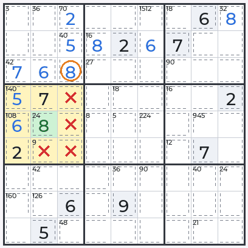

<!-- Written by tools/walkthrough.py product-killer: edit the script, not this page. -->
# Product Killer, step 11: the 8 in box 4

**Step 11 of 71** · [← Step 10](step-10.md) · [All steps](../product-killer.md#the-whole-puzzle-step-by-step) · [Step 12 →](step-12.md)

Box 4 needs an 8. r4c3, r5c3 and r6c3: column 3 has one (r3c3). r6c2: the cage's digits multiply to 9, and 8 doesn't go into it. Only **r5c2** is left: **r5c2 = 8**.

**Step 11 of 71** · [← Step 10](step-10.md) · [All steps](../product-killer.md#the-whole-puzzle-step-by-step) · [Step 12 →](step-12.md)
