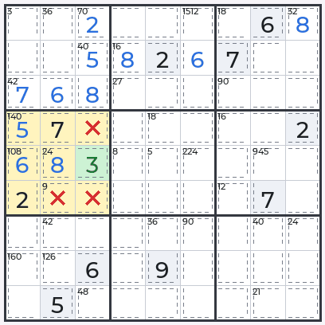

<!-- Written by tools/walkthrough.py product-killer: edit the script, not this page. -->
# Product Killer, step 12: the 3 in box 4

**Step 12 of 71** · [← Step 11](step-11.md) · [All steps](../product-killer.md#the-whole-puzzle-step-by-step) · [Step 13 →](step-13.md)

Box 4 needs a 3. r4c3: the cage of 140 (with 5 and 7 already in it) leaves 4 to make, and 3 doesn't go into it. r6c2 and r6c3: in the cage of 9, a 3 would leave 3 for its other cell, which different digits can't make. Only **r5c3** is left: **r5c3 = 3**.

**Step 12 of 71** · [← Step 11](step-11.md) · [All steps](../product-killer.md#the-whole-puzzle-step-by-step) · [Step 13 →](step-13.md)
