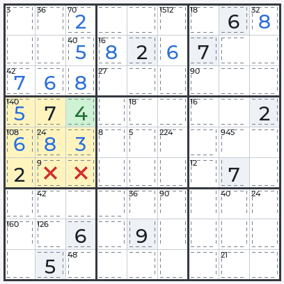

<!-- Written by tools/walkthrough.py product-killer: edit the script, not this page. -->
# Product Killer, step 13: the 4 in box 4

**Step 13 of 71** · [← Step 12](step-12.md) · [All steps](../product-killer.md#the-whole-puzzle-step-by-step) · [Step 14 →](step-14.md)

Box 4 needs a 4. r6c2 and r6c3: the cage's digits multiply to 9, and 4 doesn't go into it. Only **r4c3** is left: **r4c3 = 4**.

**Step 13 of 71** · [← Step 12](step-12.md) · [All steps](../product-killer.md#the-whole-puzzle-step-by-step) · [Step 14 →](step-14.md)
