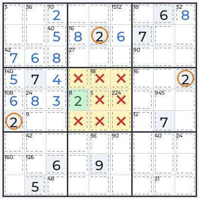

<!-- Written by tools/walkthrough.py product-killer: edit the script, not this page. -->
# Product Killer, step 14: the 2 in box 5

**Step 14 of 71** · [← Step 13](step-13.md) · [All steps](../product-killer.md#the-whole-puzzle-step-by-step) · [Step 15 →](step-15.md)

Box 5 needs a 2. r4c4, r4c5 and r4c6: row 4 has one (r4c9). r5c5: column 5 has one (r2c5). r6c4, r6c5 and r6c6: row 6 has one (r6c1). r5c6: in the cage of 224, a 2 would leave 112 for its other 2 cells, which different digits can't make. Only **r5c4** is left: **r5c4 = 2**.

**Step 14 of 71** · [← Step 13](step-13.md) · [All steps](../product-killer.md#the-whole-puzzle-step-by-step) · [Step 15 →](step-15.md)
