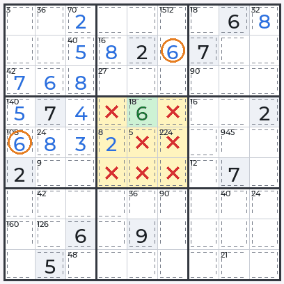

<!-- Written by tools/walkthrough.py product-killer: edit the script, not this page. -->
# Product Killer, step 15: the 6 in box 5

**Step 15 of 71** · [← Step 14](step-14.md) · [All steps](../product-killer.md#the-whole-puzzle-step-by-step) · [Step 16 →](step-16.md)

Box 5 needs a 6. r4c6 and r6c6: column 6 has one (r2c6). r5c5 and r5c6: row 5 has one (r5c1). r4c4: the cage's digits multiply to 27, and 6 doesn't go into it. r6c4: the cage of 8 (with 2 already in it) leaves 4 to make, and 6 doesn't go into it. r6c5: the cage's digits multiply to 5, and 6 doesn't go into it. Only **r4c5** is left: **r4c5 = 6**.

**Step 15 of 71** · [← Step 14](step-14.md) · [All steps](../product-killer.md#the-whole-puzzle-step-by-step) · [Step 16 →](step-16.md)
