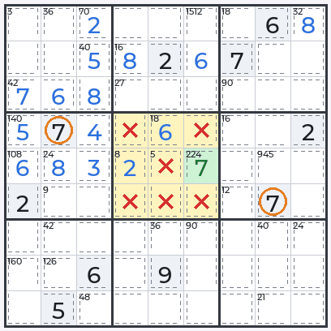

<!-- Written by tools/walkthrough.py product-killer: edit the script, not this page. -->
# Product Killer, step 16: the 7 in box 5

**Step 16 of 71** · [← Step 15](step-15.md) · [All steps](../product-killer.md#the-whole-puzzle-step-by-step) · [Step 17 →](step-17.md)

Box 5 needs a 7. r4c4 and r4c6: row 4 has one (r4c2). r6c4, r6c5 and r6c6: row 6 has one (r6c8). r5c5: the cage's digits multiply to 5, and 7 doesn't go into it. Only **r5c6** is left: **r5c6 = 7**.

**Step 16 of 71** · [← Step 15](step-15.md) · [All steps](../product-killer.md#the-whole-puzzle-step-by-step) · [Step 17 →](step-17.md)
