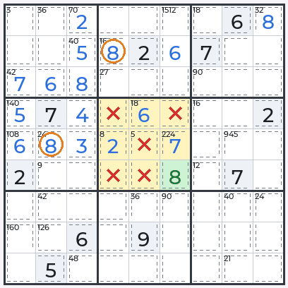

<!-- Written by tools/walkthrough.py product-killer: edit the script, not this page. -->
# Product Killer, step 17: the 8 in box 5

**Step 17 of 71** · [← Step 16](step-16.md) · [All steps](../product-killer.md#the-whole-puzzle-step-by-step) · [Step 18 →](step-18.md)

Box 5 needs an 8. r4c4 and r6c4: column 4 has one (r2c4). r5c5: row 5 has one (r5c2). r4c6: the cage of 18 (with 6 already in it) leaves 3 to make, and 8 doesn't go into it. r6c5: the cage's digits multiply to 5, and 8 doesn't go into it. Only **r6c6** is left: **r6c6 = 8**.

**Step 17 of 71** · [← Step 16](step-16.md) · [All steps](../product-killer.md#the-whole-puzzle-step-by-step) · [Step 18 →](step-18.md)
