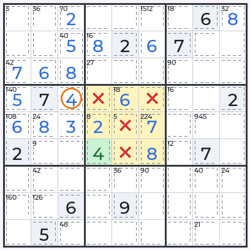

<!-- Written by tools/walkthrough.py product-killer: edit the script, not this page. -->
# Product Killer, step 18: the 4 in box 5

**Step 18 of 71** · [← Step 17](step-17.md) · [All steps](../product-killer.md#the-whole-puzzle-step-by-step) · [Step 19 →](step-19.md)

Box 5 needs a 4. r4c4 and r4c6: row 4 has one (r4c3). r5c5 and r6c5: the cage's digits multiply to 5, and 4 doesn't go into it. Only **r6c4** is left: **r6c4 = 4**.

**Step 18 of 71** · [← Step 17](step-17.md) · [All steps](../product-killer.md#the-whole-puzzle-step-by-step) · [Step 19 →](step-19.md)
