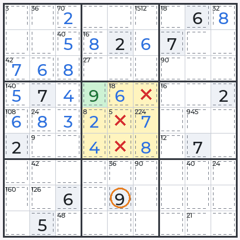

<!-- Written by tools/walkthrough.py product-killer: edit the script, not this page. -->
# Product Killer, step 19: the 9 in box 5

**Step 19 of 71** · [← Step 18](step-18.md) · [All steps](../product-killer.md#the-whole-puzzle-step-by-step) · [Step 20 →](step-20.md)

Box 5 needs a 9. r5c5 and r6c5: column 5 has one (r8c5). r4c6: the cage of 18 (with 6 already in it) leaves 3 to make, and 9 doesn't go into it. Only **r4c4** is left: **r4c4 = 9**.

**Step 19 of 71** · [← Step 18](step-18.md) · [All steps](../product-killer.md#the-whole-puzzle-step-by-step) · [Step 20 →](step-20.md)
