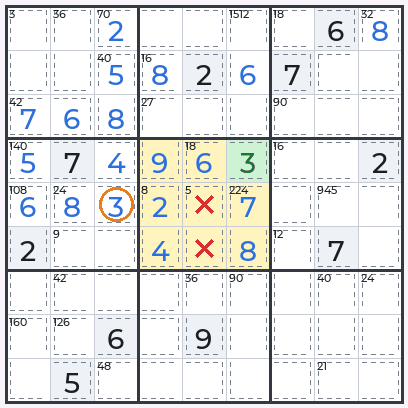

<!-- Written by tools/walkthrough.py product-killer: edit the script, not this page. -->
# Product Killer, step 20: the 3 in box 5

**Step 20 of 71** · [← Step 19](step-19.md) · [All steps](../product-killer.md#the-whole-puzzle-step-by-step) · [Step 21 →](step-21.md)

Box 5 needs a 3. r5c5: row 5 has one (r5c3). r6c5: the cage's digits multiply to 5, and 3 doesn't go into it. Only **r4c6** is left: **r4c6 = 3**.

**Step 20 of 71** · [← Step 19](step-19.md) · [All steps](../product-killer.md#the-whole-puzzle-step-by-step) · [Step 21 →](step-21.md)
