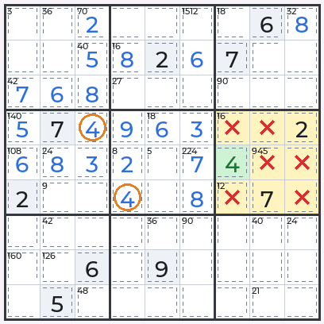

<!-- Written by tools/walkthrough.py product-killer: edit the script, not this page. -->
# Product Killer, step 21: the 4 in box 6

**Step 21 of 71** · [← Step 20](step-20.md) · [All steps](../product-killer.md#the-whole-puzzle-step-by-step) · [Step 22 →](step-22.md)

Box 6 needs a 4. r4c7 and r4c8: row 4 has one (r4c3). r6c7 and r6c9: row 6 has one (r6c4). r5c8 and r5c9: the cage of 945 (with 7 already in it) leaves 135 to make, and 4 doesn't go into it. Only **r5c7** is left: **r5c7 = 4**.

**Step 21 of 71** · [← Step 20](step-20.md) · [All steps](../product-killer.md#the-whole-puzzle-step-by-step) · [Step 22 →](step-22.md)
