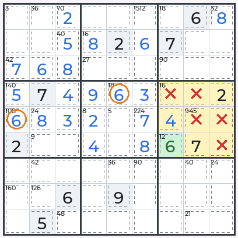

<!-- Written by tools/walkthrough.py product-killer: edit the script, not this page. -->
# Product Killer, step 22: the 6 in box 6

**Step 22 of 71** · [← Step 21](step-21.md) · [All steps](../product-killer.md#the-whole-puzzle-step-by-step) · [Step 23 →](step-23.md)

Box 6 needs a 6. r4c7 and r4c8: row 4 has one (r4c5). r5c8 and r5c9: row 5 has one (r5c1). r6c9: the cage of 945 (with 7 already in it) leaves 135 to make, and 6 doesn't go into it. Only **r6c7** is left: **r6c7 = 6**.

**Step 22 of 71** · [← Step 21](step-21.md) · [All steps](../product-killer.md#the-whole-puzzle-step-by-step) · [Step 23 →](step-23.md)
