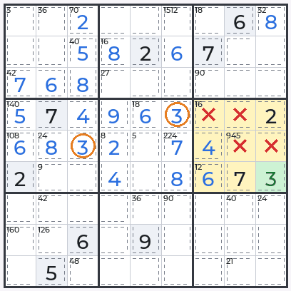

<!-- Written by tools/walkthrough.py product-killer: edit the script, not this page. -->
# Product Killer, step 23: the 3 in box 6

**Step 23 of 71** · [← Step 22](step-22.md) · [All steps](../product-killer.md#the-whole-puzzle-step-by-step) · [Step 24 →](step-24.md)

Box 6 needs a 3. r4c7 and r4c8: row 4 has one (r4c6). r5c8 and r5c9: row 5 has one (r5c3). Only **r6c9** is left: **r6c9 = 3**.

**Step 23 of 71** · [← Step 22](step-22.md) · [All steps](../product-killer.md#the-whole-puzzle-step-by-step) · [Step 24 →](step-24.md)
