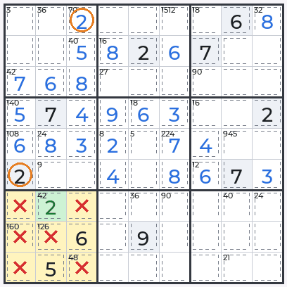

<!-- Written by tools/walkthrough.py product-killer: edit the script, not this page. -->
# Product Killer, step 24: the 2 in box 7

**Step 24 of 71** · [← Step 23](step-23.md) · [All steps](../product-killer.md#the-whole-puzzle-step-by-step) · [Step 25 →](step-25.md)

Box 7 needs a 2. r7c1, r8c1 and r9c1: column 1 has one (r6c1). r7c3 and r9c3: column 3 has one (r1c3). r8c2: the cage of 126 (with 6 already in it) leaves 21 to make, and 2 doesn't go into it. Only **r7c2** is left: **r7c2 = 2**.

**Step 24 of 71** · [← Step 23](step-23.md) · [All steps](../product-killer.md#the-whole-puzzle-step-by-step) · [Step 25 →](step-25.md)
