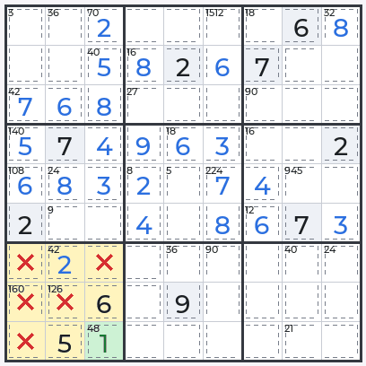

<!-- Written by tools/walkthrough.py product-killer: edit the script, not this page. -->
# Product Killer, step 25: the 1 in box 7

**Step 25 of 71** · [← Step 24](step-24.md) · [All steps](../product-killer.md#the-whole-puzzle-step-by-step) · [Step 26 →](step-26.md)

Box 7 needs a 1. r7c1: the cage of 108 (with 6 and 2 already in it) needs 9 there. r7c3: in the cage of 42 (with 2 already in it), a 1 would leave 21 for its other cell, which different digits can't make. r8c1 and r9c1: in the cage of 160 (with 5 already in it), a 1 would leave 32 for its other cell, which different digits can't make. r8c2: in the cage of 126 (with 6 already in it), a 1 would leave 21 for its other cell, which different digits can't make. Only **r9c3** is left: **r9c3 = 1**.

**Step 25 of 71** · [← Step 24](step-24.md) · [All steps](../product-killer.md#the-whole-puzzle-step-by-step) · [Step 26 →](step-26.md)
