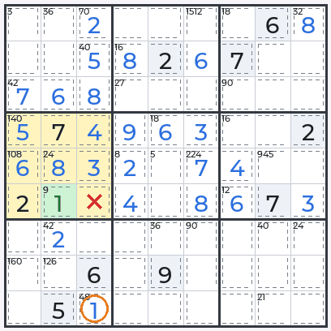

<!-- Written by tools/walkthrough.py product-killer: edit the script, not this page. -->
# Product Killer, step 26: the 1 in box 4

**Step 26 of 71** · [← Step 25](step-25.md) · [All steps](../product-killer.md#the-whole-puzzle-step-by-step) · [Step 27 →](step-27.md)

Box 4 needs a 1. r6c3: column 3 has one (r9c3). Only **r6c2** is left: **r6c2 = 1**.

**Step 26 of 71** · [← Step 25](step-25.md) · [All steps](../product-killer.md#the-whole-puzzle-step-by-step) · [Step 27 →](step-27.md)
