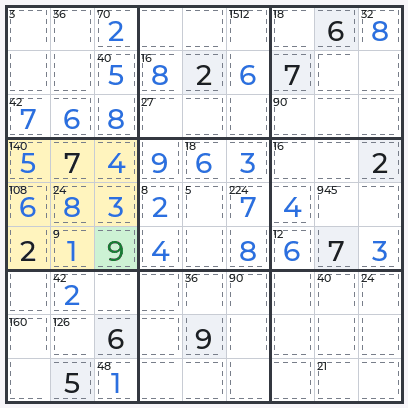

<!-- Written by tools/walkthrough.py product-killer: edit the script, not this page. -->
# Product Killer, step 27: the 9 in box 4

**Step 27 of 71** · [← Step 26](step-26.md) · [All steps](../product-killer.md#the-whole-puzzle-step-by-step) · [Step 28 →](step-28.md)

Box 4 needs a 9, and r6c3 is its last empty cell: **r6c3 = 9**.

**Step 27 of 71** · [← Step 26](step-26.md) · [All steps](../product-killer.md#the-whole-puzzle-step-by-step) · [Step 28 →](step-28.md)
