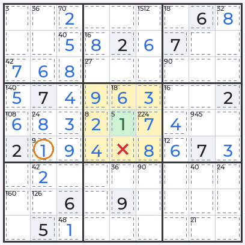

<!-- Written by tools/walkthrough.py product-killer: edit the script, not this page. -->
# Product Killer, step 28: the 1 in box 5

**Step 28 of 71** · [← Step 27](step-27.md) · [All steps](../product-killer.md#the-whole-puzzle-step-by-step) · [Step 29 →](step-29.md)

Box 5 needs a 1. r6c5: row 6 has one (r6c2). Only **r5c5** is left: **r5c5 = 1**.

**Step 28 of 71** · [← Step 27](step-27.md) · [All steps](../product-killer.md#the-whole-puzzle-step-by-step) · [Step 29 →](step-29.md)
