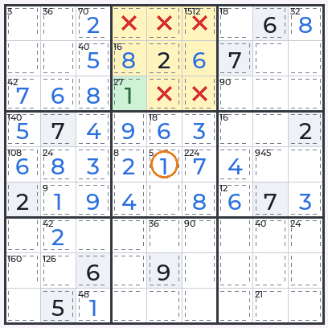

<!-- Written by tools/walkthrough.py product-killer: edit the script, not this page. -->
# Product Killer, step 29: the 1 in box 2

**Step 29 of 71** · [← Step 28](step-28.md) · [All steps](../product-killer.md#the-whole-puzzle-step-by-step) · [Step 30 →](step-30.md)

Box 2 needs a 1. r1c5 and r3c5: column 5 has one (r5c5). r1c4: in the cage of 70 (with 2 already in it), a 1 would leave 35 for its other cell, which different digits can't make. r1c6 and r3c6: in the cage of 1512 (with 6 and 7 already in it), a 1 would leave 36 for its other cell, which different digits can't make. Only **r3c4** is left: **r3c4 = 1**.

**Step 29 of 71** · [← Step 28](step-28.md) · [All steps](../product-killer.md#the-whole-puzzle-step-by-step) · [Step 30 →](step-30.md)
