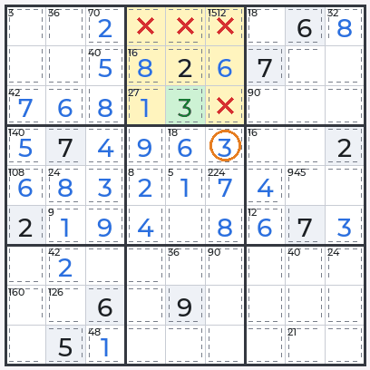

<!-- Written by tools/walkthrough.py product-killer: edit the script, not this page. -->
# Product Killer, step 30: the 3 in box 2

**Step 30 of 71** · [← Step 29](step-29.md) · [All steps](../product-killer.md#the-whole-puzzle-step-by-step) · [Step 31 →](step-31.md)

Box 2 needs a 3. r1c6 and r3c6: column 6 has one (r4c6). r1c4 and r1c5: the cage of 70 (with 2 already in it) leaves 35 to make, and 3 doesn't go into it. Only **r3c5** is left: **r3c5 = 3**.

**Step 30 of 71** · [← Step 29](step-29.md) · [All steps](../product-killer.md#the-whole-puzzle-step-by-step) · [Step 31 →](step-31.md)
