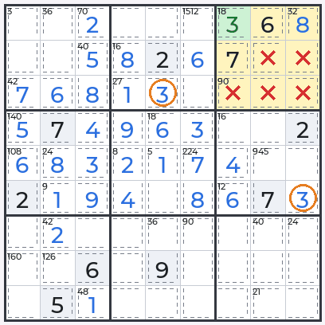

<!-- Written by tools/walkthrough.py product-killer: edit the script, not this page. -->
# Product Killer, step 31: the 3 in box 3

**Step 31 of 71** · [← Step 30](step-30.md) · [All steps](../product-killer.md#the-whole-puzzle-step-by-step) · [Step 32 →](step-32.md)

Box 3 needs a 3. r2c9: column 9 has one (r6c9). r3c7, r3c8 and r3c9: row 3 has one (r3c5). r2c8: the cage of 32 (with 8 already in it) leaves 4 to make, and 3 doesn't go into it. Only **r1c7** is left: **r1c7 = 3**.

**Step 31 of 71** · [← Step 30](step-30.md) · [All steps](../product-killer.md#the-whole-puzzle-step-by-step) · [Step 32 →](step-32.md)
