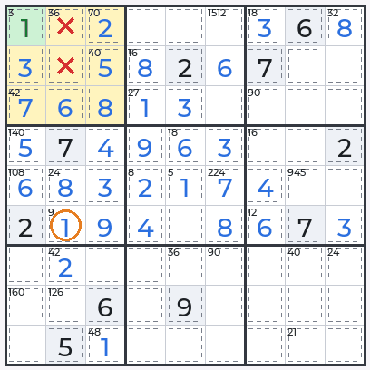

<!-- Written by tools/walkthrough.py product-killer: edit the script, not this page. -->
# Product Killer, step 33: the 1 in box 1

**Step 33 of 71** · [← Step 32](step-32.md) · [All steps](../product-killer.md#the-whole-puzzle-step-by-step) · [Step 34 →](step-34.md)

Box 1 needs a 1. r1c2 and r2c2: column 2 has one (r6c2). Only **r1c1** is left: **r1c1 = 1**.

**Step 33 of 71** · [← Step 32](step-32.md) · [All steps](../product-killer.md#the-whole-puzzle-step-by-step) · [Step 34 →](step-34.md)
