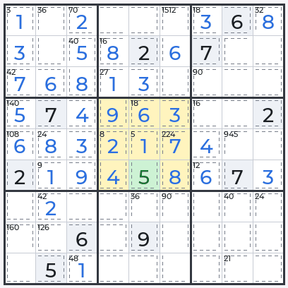

<!-- Written by tools/walkthrough.py product-killer: edit the script, not this page. -->
# Product Killer, step 34: the 5 in box 5

**Step 34 of 71** · [← Step 33](step-33.md) · [All steps](../product-killer.md#the-whole-puzzle-step-by-step) · [Step 35 →](step-35.md)

Box 5 needs a 5, and r6c5 is its last empty cell: **r6c5 = 5**.

**Step 34 of 71** · [← Step 33](step-33.md) · [All steps](../product-killer.md#the-whole-puzzle-step-by-step) · [Step 35 →](step-35.md)
