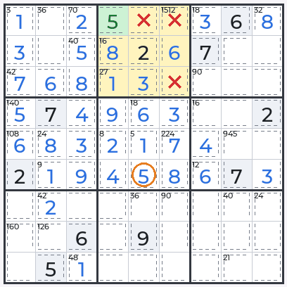

<!-- Written by tools/walkthrough.py product-killer: edit the script, not this page. -->
# Product Killer, step 35: the 5 in box 2

**Step 35 of 71** · [← Step 34](step-34.md) · [All steps](../product-killer.md#the-whole-puzzle-step-by-step) · [Step 36 →](step-36.md)

Box 2 needs a 5. r1c5: column 5 has one (r6c5). r1c6 and r3c6: the cage of 1512 (with 6 and 7 already in it) leaves 36 to make, and 5 doesn't go into it. Only **r1c4** is left: **r1c4 = 5**.

**Step 35 of 71** · [← Step 34](step-34.md) · [All steps](../product-killer.md#the-whole-puzzle-step-by-step) · [Step 36 →](step-36.md)
