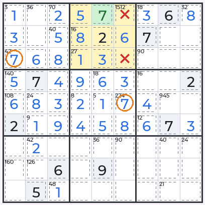

<!-- Written by tools/walkthrough.py product-killer: edit the script, not this page. -->
# Product Killer, step 36: the 7 in box 2

**Step 36 of 71** · [← Step 35](step-35.md) · [All steps](../product-killer.md#the-whole-puzzle-step-by-step) · [Step 37 →](step-37.md)

Box 2 needs a 7. r1c6: column 6 has one (r5c6). r3c6: row 3 has one (r3c1). Only **r1c5** is left: **r1c5 = 7**.

**Step 36 of 71** · [← Step 35](step-35.md) · [All steps](../product-killer.md#the-whole-puzzle-step-by-step) · [Step 37 →](step-37.md)
