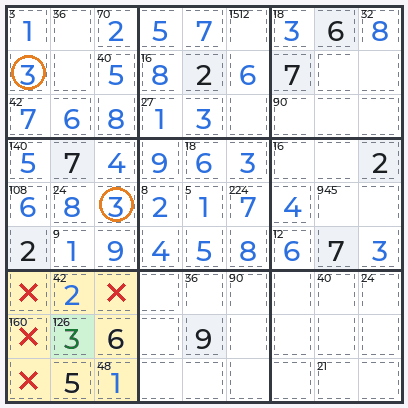

<!-- Written by tools/walkthrough.py product-killer: edit the script, not this page. -->
# Product Killer, step 37: the 3 in box 7

**Step 37 of 71** · [← Step 36](step-36.md) · [All steps](../product-killer.md#the-whole-puzzle-step-by-step) · [Step 38 →](step-38.md)

Box 7 needs a 3. r7c1, r8c1 and r9c1: column 1 has one (r2c1). r7c3: column 3 has one (r5c3). Only **r8c2** is left: **r8c2 = 3**.

**Step 37 of 71** · [← Step 36](step-36.md) · [All steps](../product-killer.md#the-whole-puzzle-step-by-step) · [Step 38 →](step-38.md)
