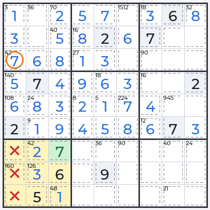

<!-- Written by tools/walkthrough.py product-killer: edit the script, not this page. -->
# Product Killer, step 38: the 7 in box 7

**Step 38 of 71** · [← Step 37](step-37.md) · [All steps](../product-killer.md#the-whole-puzzle-step-by-step) · [Step 39 →](step-39.md)

Box 7 needs a 7. r7c1, r8c1 and r9c1: column 1 has one (r3c1). Only **r7c3** is left: **r7c3 = 7**.

**Step 38 of 71** · [← Step 37](step-37.md) · [All steps](../product-killer.md#the-whole-puzzle-step-by-step) · [Step 39 →](step-39.md)
