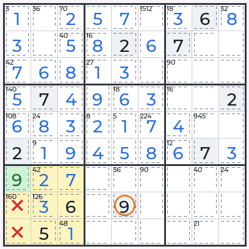

<!-- Written by tools/walkthrough.py product-killer: edit the script, not this page. -->
# Product Killer, step 39: the 9 in box 7

**Step 39 of 71** · [← Step 38](step-38.md) · [All steps](../product-killer.md#the-whole-puzzle-step-by-step) · [Step 40 →](step-40.md)

Box 7 needs a 9. r8c1: row 8 has one (r8c5). r9c1: the cage of 160 (with 5 already in it) leaves 32 to make, and 9 doesn't go into it. Only **r7c1** is left: **r7c1 = 9**.

**Step 39 of 71** · [← Step 38](step-38.md) · [All steps](../product-killer.md#the-whole-puzzle-step-by-step) · [Step 40 →](step-40.md)
