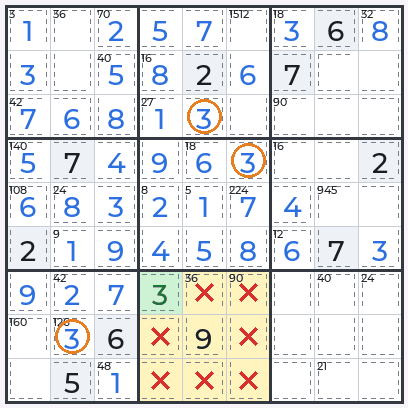

<!-- Written by tools/walkthrough.py product-killer: edit the script, not this page. -->
# Product Killer, step 40: the 3 in box 8

**Step 40 of 71** · [← Step 39](step-39.md) · [All steps](../product-killer.md#the-whole-puzzle-step-by-step) · [Step 41 →](step-41.md)

Box 8 needs a 3. r7c5 and r9c5: column 5 has one (r3c5). r7c6 and r9c6: column 6 has one (r4c6). r8c4 and r8c6: row 8 has one (r8c2). r9c4: in the cage of 48 (with 1 already in it), a 3 would leave 16 for its other cell, which different digits can't make. Only **r7c4** is left: **r7c4 = 3**.

**Step 40 of 71** · [← Step 39](step-39.md) · [All steps](../product-killer.md#the-whole-puzzle-step-by-step) · [Step 41 →](step-41.md)
