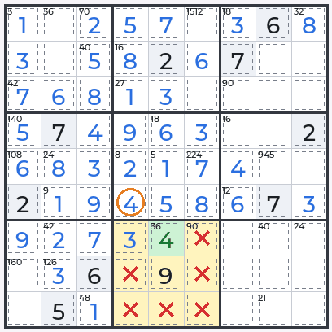

<!-- Written by tools/walkthrough.py product-killer: edit the script, not this page. -->
# Product Killer, step 41: the 4 in box 8

**Step 41 of 71** · [← Step 40](step-40.md) · [All steps](../product-killer.md#the-whole-puzzle-step-by-step) · [Step 42 →](step-42.md)

Box 8 needs a 4. r8c4 and r9c4: column 4 has one (r6c4). r7c6, r8c6 and r9c6: the cage's digits multiply to 90, and 4 doesn't go into it. r9c5: in the cage of 48 (with 1 already in it), a 4 would leave 12 for its other cell, which different digits can't make. Only **r7c5** is left: **r7c5 = 4**.

**Step 41 of 71** · [← Step 40](step-40.md) · [All steps](../product-killer.md#the-whole-puzzle-step-by-step) · [Step 42 →](step-42.md)
