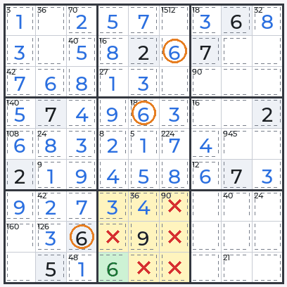

<!-- Written by tools/walkthrough.py product-killer: edit the script, not this page. -->
# Product Killer, step 42: the 6 in box 8

**Step 42 of 71** · [← Step 41](step-41.md) · [All steps](../product-killer.md#the-whole-puzzle-step-by-step) · [Step 43 →](step-43.md)

Box 8 needs a 6. r7c6 and r9c6: column 6 has one (r2c6). r8c4 and r8c6: row 8 has one (r8c3). r9c5: column 5 has one (r4c5). Only **r9c4** is left: **r9c4 = 6**.

**Step 42 of 71** · [← Step 41](step-41.md) · [All steps](../product-killer.md#the-whole-puzzle-step-by-step) · [Step 43 →](step-43.md)
