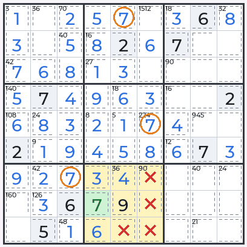

<!-- Written by tools/walkthrough.py product-killer: edit the script, not this page. -->
# Product Killer, step 43: the 7 in box 8

**Step 43 of 71** · [← Step 42](step-42.md) · [All steps](../product-killer.md#the-whole-puzzle-step-by-step) · [Step 44 →](step-44.md)

Box 8 needs a 7. r7c6: row 7 has one (r7c3). r8c6 and r9c6: column 6 has one (r5c6). r9c5: column 5 has one (r1c5). Only **r8c4** is left: **r8c4 = 7**.

**Step 43 of 71** · [← Step 42](step-42.md) · [All steps](../product-killer.md#the-whole-puzzle-step-by-step) · [Step 44 →](step-44.md)
