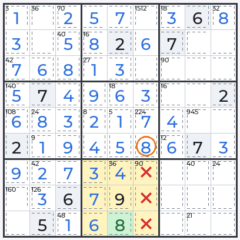

<!-- Written by tools/walkthrough.py product-killer: edit the script, not this page. -->
# Product Killer, step 44: the 8 in box 8

**Step 44 of 71** · [← Step 43](step-43.md) · [All steps](../product-killer.md#the-whole-puzzle-step-by-step) · [Step 45 →](step-45.md)

Box 8 needs an 8. r7c6, r8c6 and r9c6: column 6 has one (r6c6). Only **r9c5** is left: **r9c5 = 8**.

**Step 44 of 71** · [← Step 43](step-43.md) · [All steps](../product-killer.md#the-whole-puzzle-step-by-step) · [Step 45 →](step-45.md)
