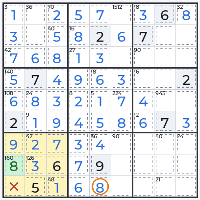

<!-- Written by tools/walkthrough.py product-killer: edit the script, not this page. -->
# Product Killer, step 45: the 8 in box 7

**Step 45 of 71** · [← Step 44](step-44.md) · [All steps](../product-killer.md#the-whole-puzzle-step-by-step) · [Step 46 →](step-46.md)

Box 7 needs an 8. r9c1: row 9 has one (r9c5). Only **r8c1** is left: **r8c1 = 8**.

**Step 45 of 71** · [← Step 44](step-44.md) · [All steps](../product-killer.md#the-whole-puzzle-step-by-step) · [Step 46 →](step-46.md)
