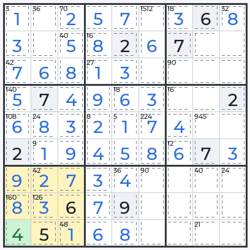

<!-- Written by tools/walkthrough.py product-killer: edit the script, not this page. -->
# Product Killer, step 46: the 4 in box 7

**Step 46 of 71** · [← Step 45](step-45.md) · [All steps](../product-killer.md#the-whole-puzzle-step-by-step) · [Step 47 →](step-47.md)

Box 7 needs a 4, and r9c1 is its last empty cell: **r9c1 = 4**.

**Step 46 of 71** · [← Step 45](step-45.md) · [All steps](../product-killer.md#the-whole-puzzle-step-by-step) · [Step 47 →](step-47.md)
