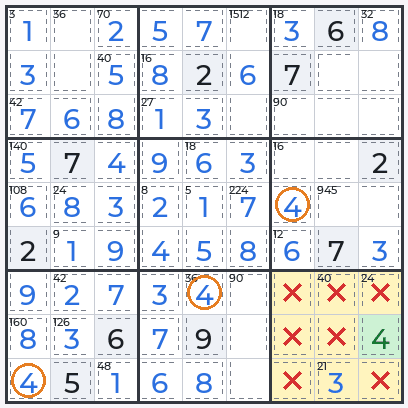

<!-- Written by tools/walkthrough.py product-killer: edit the script, not this page. -->
# Product Killer, step 48: the 4 in box 9

**Step 48 of 71** · [← Step 47](step-47.md) · [All steps](../product-killer.md#the-whole-puzzle-step-by-step) · [Step 49 →](step-49.md)

Box 9 needs a 4. r7c7, r7c8 and r7c9: row 7 has one (r7c5). r8c7: column 7 has one (r5c7). r9c7 and r9c9: row 9 has one (r9c1). r8c8: in the cage of 40, a 4 would leave 10 for its other cell, which different digits can't make. Only **r8c9** is left: **r8c9 = 4**.

**Step 48 of 71** · [← Step 47](step-47.md) · [All steps](../product-killer.md#the-whole-puzzle-step-by-step) · [Step 49 →](step-49.md)
