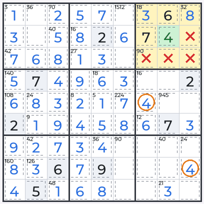

<!-- Written by tools/walkthrough.py product-killer: edit the script, not this page. -->
# Product Killer, step 49: the 4 in box 3

**Step 49 of 71** · [← Step 48](step-48.md) · [All steps](../product-killer.md#the-whole-puzzle-step-by-step) · [Step 50 →](step-50.md)

Box 3 needs a 4. r2c9 and r3c9: column 9 has one (r8c9). r3c7: column 7 has one (r5c7). r3c8: the cage's digits multiply to 90, and 4 doesn't go into it. Only **r2c8** is left: **r2c8 = 4**.

**Step 49 of 71** · [← Step 48](step-48.md) · [All steps](../product-killer.md#the-whole-puzzle-step-by-step) · [Step 50 →](step-50.md)
