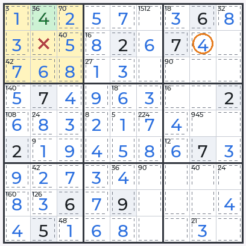

<!-- Written by tools/walkthrough.py product-killer: edit the script, not this page. -->
# Product Killer, step 50: the 4 in box 1

**Step 50 of 71** · [← Step 49](step-49.md) · [All steps](../product-killer.md#the-whole-puzzle-step-by-step) · [Step 51 →](step-51.md)

Box 1 needs a 4. r2c2: row 2 has one (r2c8). Only **r1c2** is left: **r1c2 = 4**.

**Step 50 of 71** · [← Step 49](step-49.md) · [All steps](../product-killer.md#the-whole-puzzle-step-by-step) · [Step 51 →](step-51.md)
