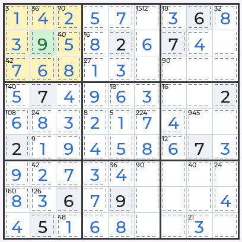

<!-- Written by tools/walkthrough.py product-killer: edit the script, not this page. -->
# Product Killer, step 51: the 9 in box 1

**Step 51 of 71** · [← Step 50](step-50.md) · [All steps](../product-killer.md#the-whole-puzzle-step-by-step) · [Step 52 →](step-52.md)

Box 1 needs a 9, and r2c2 is its last empty cell: **r2c2 = 9**.

**Step 51 of 71** · [← Step 50](step-50.md) · [All steps](../product-killer.md#the-whole-puzzle-step-by-step) · [Step 52 →](step-52.md)
