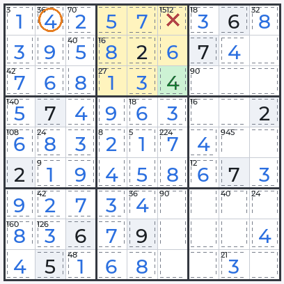

<!-- Written by tools/walkthrough.py product-killer: edit the script, not this page. -->
# Product Killer, step 52: the 4 in box 2

**Step 52 of 71** · [← Step 51](step-51.md) · [All steps](../product-killer.md#the-whole-puzzle-step-by-step) · [Step 53 →](step-53.md)

Box 2 needs a 4. r1c6: row 1 has one (r1c2). Only **r3c6** is left: **r3c6 = 4**.

**Step 52 of 71** · [← Step 51](step-51.md) · [All steps](../product-killer.md#the-whole-puzzle-step-by-step) · [Step 53 →](step-53.md)
