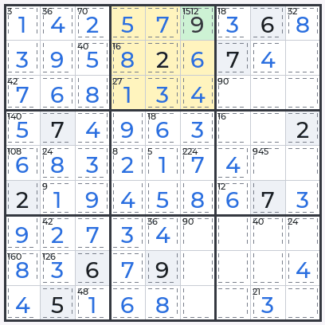

<!-- Written by tools/walkthrough.py product-killer: edit the script, not this page. -->
# Product Killer, step 53: the 9 in box 2

**Step 53 of 71** · [← Step 52](step-52.md) · [All steps](../product-killer.md#the-whole-puzzle-step-by-step) · [Step 54 →](step-54.md)

Box 2 needs a 9, and r1c6 is its last empty cell: **r1c6 = 9**.

**Step 53 of 71** · [← Step 52](step-52.md) · [All steps](../product-killer.md#the-whole-puzzle-step-by-step) · [Step 54 →](step-54.md)
