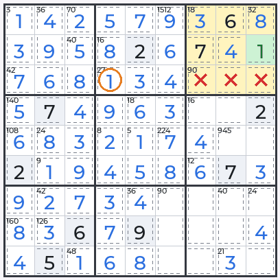

<!-- Written by tools/walkthrough.py product-killer: edit the script, not this page. -->
# Product Killer, step 54: the 1 in box 3

**Step 54 of 71** · [← Step 53](step-53.md) · [All steps](../product-killer.md#the-whole-puzzle-step-by-step) · [Step 55 →](step-55.md)

Box 3 needs a 1. r3c7, r3c8 and r3c9: row 3 has one (r3c4). Only **r2c9** is left: **r2c9 = 1**.

**Step 54 of 71** · [← Step 53](step-53.md) · [All steps](../product-killer.md#the-whole-puzzle-step-by-step) · [Step 55 →](step-55.md)
