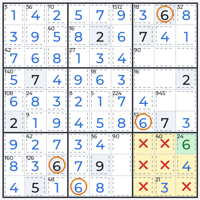

<!-- Written by tools/walkthrough.py product-killer: edit the script, not this page. -->
# Product Killer, step 55: the 6 in box 9

**Step 55 of 71** · [← Step 54](step-54.md) · [All steps](../product-killer.md#the-whole-puzzle-step-by-step) · [Step 56 →](step-56.md)

Box 9 needs a 6. r7c7: column 7 has one (r6c7). r7c8: column 8 has one (r1c8). r8c7 and r8c8: row 8 has one (r8c3). r9c7 and r9c9: row 9 has one (r9c4). Only **r7c9** is left: **r7c9 = 6**.

**Step 55 of 71** · [← Step 54](step-54.md) · [All steps](../product-killer.md#the-whole-puzzle-step-by-step) · [Step 56 →](step-56.md)
