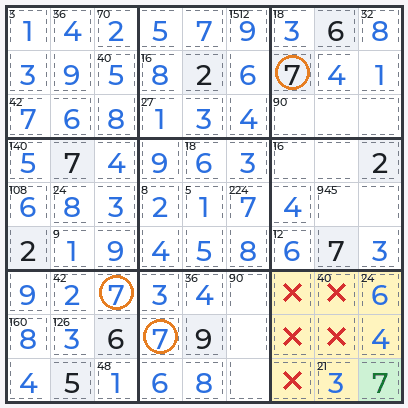

<!-- Written by tools/walkthrough.py product-killer: edit the script, not this page. -->
# Product Killer, step 56: the 7 in box 9

**Step 56 of 71** · [← Step 55](step-55.md) · [All steps](../product-killer.md#the-whole-puzzle-step-by-step) · [Step 57 →](step-57.md)

Box 9 needs a 7. r7c7 and r7c8: row 7 has one (r7c3). r8c7 and r8c8: row 8 has one (r8c4). r9c7: column 7 has one (r2c7). Only **r9c9** is left: **r9c9 = 7**.

**Step 56 of 71** · [← Step 55](step-55.md) · [All steps](../product-killer.md#the-whole-puzzle-step-by-step) · [Step 57 →](step-57.md)
