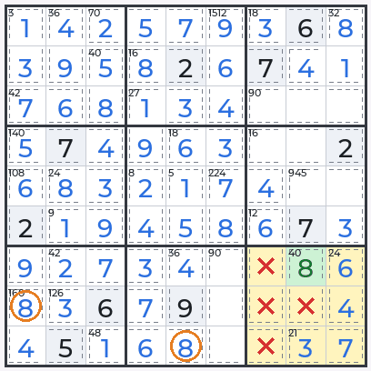

<!-- Written by tools/walkthrough.py product-killer: edit the script, not this page. -->
# Product Killer, step 57: the 8 in box 9

**Step 57 of 71** · [← Step 56](step-56.md) · [All steps](../product-killer.md#the-whole-puzzle-step-by-step) · [Step 58 →](step-58.md)

Box 9 needs an 8. r8c7 and r8c8: row 8 has one (r8c1). r9c7: row 9 has one (r9c5). r7c7: the cage of 12 (with 6 already in it) leaves 2 to make, and 8 doesn't go into it. Only **r7c8** is left: **r7c8 = 8**.

**Step 57 of 71** · [← Step 56](step-56.md) · [All steps](../product-killer.md#the-whole-puzzle-step-by-step) · [Step 58 →](step-58.md)
