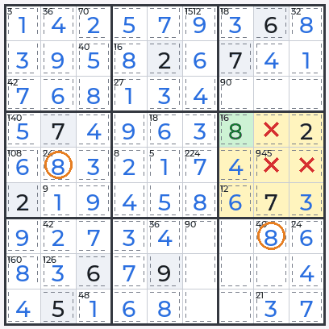

<!-- Written by tools/walkthrough.py product-killer: edit the script, not this page. -->
# Product Killer, step 58: the 8 in box 6

**Step 58 of 71** · [← Step 57](step-57.md) · [All steps](../product-killer.md#the-whole-puzzle-step-by-step) · [Step 59 →](step-59.md)

Box 6 needs an 8. r4c8: column 8 has one (r7c8). r5c8 and r5c9: row 5 has one (r5c2). Only **r4c7** is left: **r4c7 = 8**.

**Step 58 of 71** · [← Step 57](step-57.md) · [All steps](../product-killer.md#the-whole-puzzle-step-by-step) · [Step 59 →](step-59.md)
