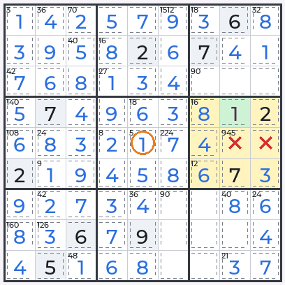

<!-- Written by tools/walkthrough.py product-killer: edit the script, not this page. -->
# Product Killer, step 59: the 1 in box 6

**Step 59 of 71** · [← Step 58](step-58.md) · [All steps](../product-killer.md#the-whole-puzzle-step-by-step) · [Step 60 →](step-60.md)

Box 6 needs a 1. r5c8 and r5c9: row 5 has one (r5c5). Only **r4c8** is left: **r4c8 = 1**.

**Step 59 of 71** · [← Step 58](step-58.md) · [All steps](../product-killer.md#the-whole-puzzle-step-by-step) · [Step 60 →](step-60.md)
