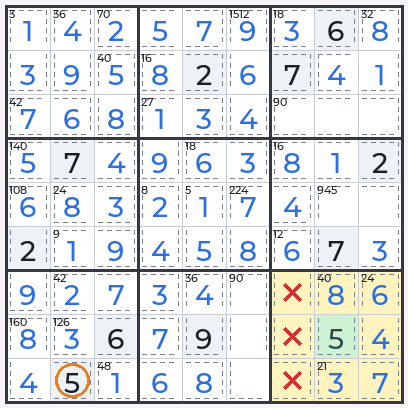

<!-- Written by tools/walkthrough.py product-killer: edit the script, not this page. -->
# Product Killer, step 60: the 5 in box 9

**Step 60 of 71** · [← Step 59](step-59.md) · [All steps](../product-killer.md#the-whole-puzzle-step-by-step) · [Step 61 →](step-61.md)

Box 9 needs a 5. r9c7: row 9 has one (r9c2). r7c7 and r8c7: the cage of 12 (with 6 already in it) leaves 2 to make, and 5 doesn't go into it. Only **r8c8** is left: **r8c8 = 5**.

**Step 60 of 71** · [← Step 59](step-59.md) · [All steps](../product-killer.md#the-whole-puzzle-step-by-step) · [Step 61 →](step-61.md)
