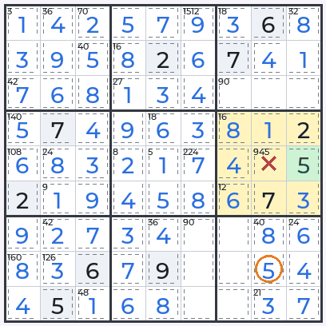

<!-- Written by tools/walkthrough.py product-killer: edit the script, not this page. -->
# Product Killer, step 61: the 5 in box 6

**Step 61 of 71** · [← Step 60](step-60.md) · [All steps](../product-killer.md#the-whole-puzzle-step-by-step) · [Step 62 →](step-62.md)

Box 6 needs a 5. r5c8: column 8 has one (r8c8). Only **r5c9** is left: **r5c9 = 5**.

**Step 61 of 71** · [← Step 60](step-60.md) · [All steps](../product-killer.md#the-whole-puzzle-step-by-step) · [Step 62 →](step-62.md)
