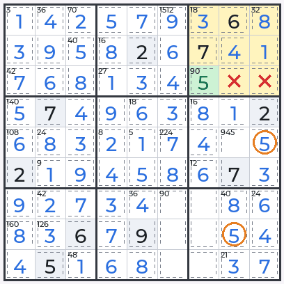

<!-- Written by tools/walkthrough.py product-killer: edit the script, not this page. -->
# Product Killer, step 62: the 5 in box 3

**Step 62 of 71** · [← Step 61](step-61.md) · [All steps](../product-killer.md#the-whole-puzzle-step-by-step) · [Step 63 →](step-63.md)

Box 3 needs a 5. r3c8: column 8 has one (r8c8). r3c9: column 9 has one (r5c9). Only **r3c7** is left: **r3c7 = 5**.

**Step 62 of 71** · [← Step 61](step-61.md) · [All steps](../product-killer.md#the-whole-puzzle-step-by-step) · [Step 63 →](step-63.md)
